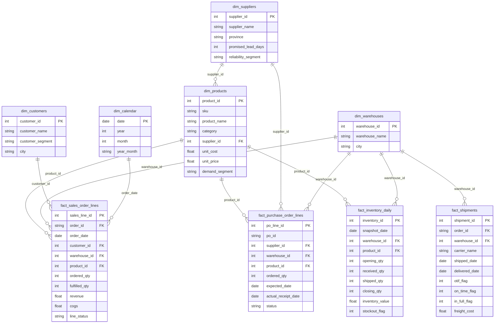

# FMCG Supply Chain Performance & Inventory Optimization

[](https://www.sqlite.org/)
[](https://python.org)
[](https://powerbi.microsoft.com/)
[]()
[](LICENSE)

> ⚠️ **All data is synthetic/simulated.** This is a data analytics portfolio project. All company names, suppliers, customers, orders, and financial figures are fictional. Results describe the simulated dataset only — not any real business or industry.

A complete end-to-end **Supply Chain Analytics** portfolio project simulating a fictional FMCG distributor facing chronic fulfillment failures. Built to demonstrate proficiency in SQL, Python, and Power BI for a **Data Analyst** role.

---

## 📋 Business Problem

A simulated FMCG distributor (Apr–Sep 2026) is experiencing:
- **Low fill rate** — 1 in 4 ordered units cannot be shipped
- **Poor OTIF** — over half of orders miss completeness or timing commitments
- **Unreliable supply** — only 1 in 3 purchase orders arrives on time

The objective: diagnose root causes using data, propose measurable priority actions, and build reproducible analytics artifacts.

---

## 📊 Key Results (Synthetic Dataset)

| KPI | Value | Definition |
|---|---:|---|
| Fill Rate (unit) | **74.15%** | fulfilled_qty / ordered_qty across all order lines |
| OTIF (order) | **42.90%** | Orders complete AND delivered ≤ promised date |
| Supplier OTD | **35.95%** | POs received ≤ expected date (received POs only) |
| Stockout Snapshot Share | **14.31%** | SKU-warehouse-day snapshots with closing stock = 0 |
| Revenue Fulfilled | **Rp 3.32 B** | fulfilled_qty × unit_price |
| Unserved Order Value | **~Rp 1.01 B** | Indicative demand gap (not confirmed lost revenue) |
| SKUs at High Inventory Risk | **70 / 144** | SKU-warehouse combos below 95% service level ROP |

---

## 🗂️ Data Architecture



---

## 🔑 Five Business Questions Answered

| # | Question | Key Finding |
|---|---|---|
| 1 | Which products & warehouses fail fulfillment most? | Top 15 SKU-warehouse combos identified; stockout days concentrated in Fast-moving SKUs |
| 2 | Is the problem stock, supplier, or delivery? | Supplier OTD (35.95%) is the primary upstream driver; delivery lateness is secondary |
| 3 | Which suppliers are least consistent? | 2–3 suppliers with both low OTD and long avg lead time create highest replenishment risk |
| 4 | Does all inventory need to increase, or only specific SKUs? | 68/144 SKU-warehouse combos are below 95% ROP threshold — targeted, not universal increase |
| 5 | What's the highest-impact, lowest-cost action? | Reorder point recalibration on top-20 Unserved Order Value SKUs + supplier SLA exception tracking |

---

## 🛠️ Project Structure

```
scm-portfolio/
├── SCM_Portfolio_Starter/
│   ├── 00_PROJECT_BRIEF.md           # Business context & KPI definitions
│   ├── 01_Data/                      # 9 CSV files + Data Dictionary
│   │   ├── dim_products.csv
│   │   ├── dim_suppliers.csv
│   │   ├── dim_warehouses.csv
│   │   ├── dim_customers.csv
│   │   ├── dim_calendar.csv
│   │   ├── fact_sales_order_lines.csv
│   │   ├── fact_shipments.csv
│   │   ├── fact_purchase_order_lines.csv
│   │   ├── fact_inventory_daily.csv
│   │   └── DATA_DICTIONARY.md
│   ├── 02_Database/                  # SQLite database + schema
│   │   └── scm_portfolio.sqlite
│   ├── 03_SQL/                       # SQL queries & analysis
│   │   ├── solutions_16_queries.sql  # 16 solved queries
│   │   └── sql_analysis_final.md    # Queries + business insights ⭐
│   ├── 04_Python/                    # Python scripts (stdlib only)
│   │   ├── generate_data.py          # Data generator (seed=2026)
│   │   ├── analyze_scm.py            # KPI computation & reports
│   │   ├── replenishment_scenarios.py # ROP scenario analysis
│   │   ├── test_project.py           # 8 data integrity tests
│   │   └── test_forecast.py          # Forecast backtest
│   ├── 05_PowerBI/                   # Power BI resources
│   │   ├── DAX_Measures.txt          # 25 DAX measures
│   │   └── MODEL_DATA.md             # Star schema guidance
│   ├── 06_Career/                    # Learning roadmap & interview prep
│   └── 07_Reports/                   # Analysis outputs ⭐
│       ├── executive_memo_final.md   # 2-page business memo ⭐
│       ├── executive_summary.md      # KPI summary
│       ├── forecast_and_replenishment_summary.md
│       ├── OTIF_ROOT_CAUSE_HYPOTHESES.md
│       └── [CSV outputs from analyze_scm.py]
├── portfolio/
│   └── index.html                    # Interactive web portfolio ⭐
└── README.md                         # This file
```

---

## ⚙️ How to Reproduce

### Prerequisites
- Python 3.x (no external packages required — uses stdlib only)
- [DB Browser for SQLite](https://sqlitebrowser.org/) (for SQL exploration)
- [Power BI Desktop](https://powerbi.microsoft.com/desktop/) (for dashboard)

### Run Python Analysis

```powershell
# From SCM_Portfolio_Starter directory
cd SCM_Portfolio_Starter

# 1. Validate data integrity (8 tests)
py 04_Python\test_project.py

# 2. Run full KPI analysis
py 04_Python\analyze_scm.py

# 3. Run reorder point scenarios
py 04_Python\replenishment_scenarios.py

# 4. Run forecast backtest
py 04_Python\test_forecast.py
```

### Regenerate Data (Optional)
```powershell
# WARNING: This overwrites existing CSVs and SQLite database
py 04_Python\generate_data.py
py 04_Python\test_project.py    # Verify integrity after regeneration
```

### Open SQL Analysis
1. Open `02_Database/scm_portfolio.sqlite` in DB Browser for SQLite
2. Run queries from `03_SQL/solutions_16_queries.sql` one at a time
3. Read narrative insights in `03_SQL/sql_analysis_final.md`

---

## 📈 Methodology Flow

```
Raw CSV Data
    ↓
SQLite Database (scm_portfolio.sqlite)
    ↓
16 SQL Queries → Business Insights (sql_analysis_final.md)
    ↓
Python Analysis Scripts
    ├── KPI aggregation (analyze_scm.py)
    ├── Demand forecasting backtest (test_forecast.py)
    └── ROP scenario modeling (replenishment_scenarios.py)
    ↓
Report Outputs (07_Reports/)
    ├── executive_memo_final.md
    ├── supplier_performance.csv
    ├── sku_inventory_risk_last_30d.csv
    └── reorder_point_service_level_scenarios.csv
    ↓
Power BI Dashboard (4 pages)
    ├── Executive Overview
    ├── Inventory & Stockout
    ├── Procurement & Supplier
    └── Logistics & Carrier
```

---

## 🔮 Key Findings

1. **Supplier reliability is the primary bottleneck.** At 35.95% OTD, the replenishment pipeline is chronically delayed. Fast-moving SKUs with unreliable suppliers consistently appear in both the high-stockout-day and high-unserved-value rankings.

2. **OTIF failure is dual-cause, not single-cause.** 19% of orders (942) fail both completeness and timing simultaneously — compounded failures that require both supply and delivery interventions, not just one.

3. **Stockout risk is concentrated, not universal.** 70 out of 144 SKU-warehouse combinations are below the 95% service level reorder threshold, but the top 20 by Unserved Order Value account for a disproportionate share of the gap — targeted action outperforms blanket safety stock increases.

4. **ABC classification reveals misaligned inventory priorities.** Class A SKUs (top 80% of revenue) must be protected with higher service level targets, while Class C items can sustain leaner replenishment policies.

5. **Inventory Turnover trend combined with stockout data reveals maldistribution.** Some SKU-warehouse combinations hold excess stock while fast movers stock out — a distribution problem as much as a volume problem.

---

## ⚠️ Limitations & Disclaimers

- Dataset is **100% synthetic** — not real FMCG company data
- Reorder point scenarios assume **independent demand and lead time** (normal distribution approximation)
- Carrying cost assumptions use **20% p.a. of standard unit cost** — not an actual company rate
- Inventory Turnover figures are **period-specific**, not annualized
- Forecast WAPE is **high by design** due to intermittent demand patterns in the simulated dataset
- `Unserved Order Value` is indicative demand gap — **not confirmed lost revenue**
- No backorders, returns, shrinkage, or multi-sourcing modeled

---

## 👤 Author

**Pandu Pramana**
Data Analyst | Supply Chain Analytics Enthusiast
📧 apandoop@gmail.com
🔗 [github.com/pandupramana](https://github.com/pandupramana)

---

## 📄 License

This project is licensed under the MIT License. The synthetic dataset is freely usable for learning and portfolio purposes.
